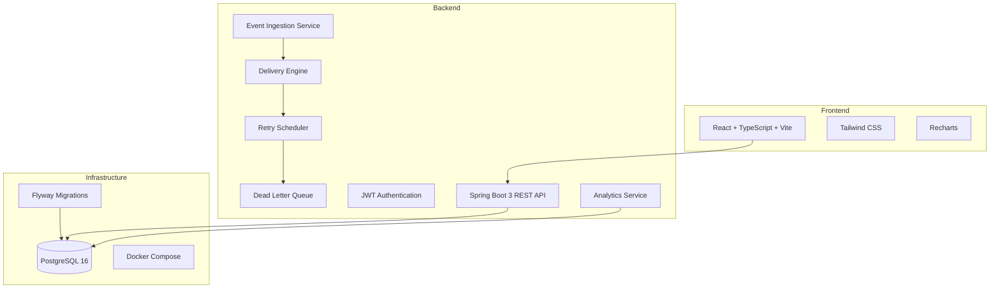
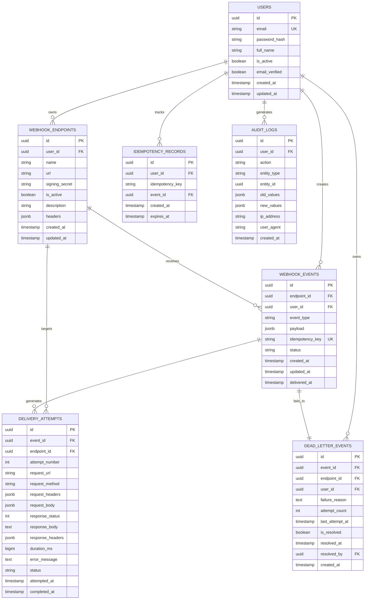

# HookVault

A webhook management, delivery monitoring, reliability, and recovery platform for developers.

HookVault allows developers to register webhook endpoints, send events, monitor delivery attempts, automatically retry failed deliveries, inspect request/response history, and replay events. Inspired by Stripe Webhooks, Svix, and modern API monitoring platforms.

## Features

- **Authentication & User Management** - Secure registration, login, JWT-based authentication with BCrypt password hashing
- **Webhook Endpoint Management** - Create, configure, enable/disable endpoints with signing secrets and custom headers
- **Event Ingestion** - RESTful API for ingesting events with idempotency protection
- **Reliable Delivery Engine** - HTTP POST delivery with HMAC-SHA256 signatures, timeout handling, and concurrent processing
- **Automatic Retries** - Configurable exponential backoff (5s, 30s, 2m, 10m, 30m) with dead-letter queue
- **Manual Replay** - Replay individual failed events or retry dead-lettered events
- **Dead Letter Queue** - Permanent failure storage with failure reasons, attempt counts, and recovery options
- **Request/Response Inspector** - Full inspection of every delivery attempt with redacted secrets
- **Analytics Dashboard** - Real-time metrics: success rates, response times, volume over time, endpoint performance
- **Developer Experience** - Search, filter, pagination, sorting, and comprehensive API documentation

## Architecture



## Technology Stack

### Backend
- Java 21
- Spring Boot 3.3
- Spring Web, Data JPA, Security, Validation
- PostgreSQL 16
- Flyway for migrations
- JJWT for JWT tokens
- Apache HttpClient 5 for deliveries
- Springdoc OpenAPI for Swagger
- JUnit 5, Mockito, Testcontainers for testing

### Frontend
- React 18 with TypeScript
- Vite for build tooling
- Tailwind CSS for styling
- React Router for navigation
- React Hook Form + Zod for forms
- Recharts for analytics
- Lucide React for icons
- Axios for API calls
- React Hot Toast for notifications

### Infrastructure
- Docker & Docker Compose
- GitHub Actions for CI/CD
- PostgreSQL 16

## Database Schema



## API Documentation

### Authentication
```
POST   /api/v1/auth/register     - Register new user
POST   /api/v1/auth/login        - Login
POST   /api/v1/auth/refresh      - Refresh access token
POST   /api/v1/auth/logout       - Logout
```

### Endpoints
```
GET    /api/v1/endpoints         - List user's endpoints (paginated)
POST   /api/v1/endpoints         - Create new endpoint
GET    /api/v1/endpoints/{id}    - Get endpoint details
PATCH  /api/v1/endpoints/{id}    - Update endpoint
POST   /api/v1/endpoints/{id}/rotate-secret - Rotate signing secret
DELETE /api/v1/endpoints/{id}    - Delete endpoint
```

### Events
```
POST   /api/v1/events            - Ingest new event
GET    /api/v1/events            - List events (paginated, filterable)
GET    /api/v1/events/{id}       - Get event details
```

### Delivery Attempts
```
GET    /api/v1/delivery-attempts              - List attempts (paginated)
GET    /api/v1/delivery-attempts/{id}         - Get attempt details
GET    /api/v1/delivery-attempts/event/{eventId} - Get attempts for event
```

### Dead Letters
```
GET    /api/v1/dead-letters       - List dead letters (paginated)
GET    /api/v1/dead-letters/{id}  - Get dead letter details
POST   /api/v1/dead-letters/{id}/replay     - Replay dead letter event
POST   /api/v1/dead-letters/{id}/resolve    - Mark as resolved
DELETE /api/v1/dead-letters/{id}  - Dismiss dead letter
```

### Analytics
```
GET    /api/v1/analytics/dashboard - Get dashboard metrics
```

## Example Webhook Request

### Ingesting an Event
```bash
curl -X POST http://localhost:8080/api/v1/events \
  -H "Authorization: Bearer YOUR_JWT_TOKEN" \
  -H "Content-Type: application/json" \
  -d '{
    "eventType": "payment.succeeded",
    "endpointId": "550e8400-e29b-41d4-a716-446655440000",
    "payload": {
      "paymentId": "pay_123",
      "amount": 1000,
      "currency": "usd"
    },
    "idempotencyKey": "evt_payment_123_unique_key"
  }'
```

### Example Delivery (what HookVault sends to your endpoint)
```http
POST https://your-app.com/webhooks
Content-Type: application/json
X-HookVault-Event-ID: 550e8400-e29b-41d4-a716-446655440001
X-HookVault-Event-Type: payment.succeeded
X-HookVault-Signature: sha256=abc123...
X-HookVault-Delivery-Attempt: 1
User-Agent: HookVault/1.0

{
  "paymentId": "pay_123",
  "amount": 1000,
  "currency": "usd"
}
```

### Verifying Signatures (Node.js Example)
```javascript
const crypto = require('crypto');

function verifySignature(payload, signature, secret) {
  const expectedSignature = 'sha256=' + crypto
    .createHmac('sha256', secret)
    .update(payload)
    .digest('base64');
  
  // Constant-time comparison
  return crypto.timingSafeEqual(
    Buffer.from(signature),
    Buffer.from(expectedSignature)
  );
}

// Usage in Express
app.post('/webhooks', express.raw({ type: 'application/json' }), (req, res) => {
  const signature = req.headers['x-hookvault-signature'];
  const secret = process.env.WEBHOOK_SIGNING_SECRET;
  
  if (!verifySignature(req.body, signature, secret)) {
    return res.status(401).send('Invalid signature');
  }
  
  const event = JSON.parse(req.body);
  // Process event...
  res.status(200).send('OK');
});
```

## Retry Mechanism

HookVault implements a configurable retry schedule with exponential backoff:

| Attempt | Delay | Description |
|---------|-------|-------------|
| 1 | 5 seconds | Immediate retry |
| 2 | 30 seconds | Short delay |
| 3 | 2 minutes | Medium delay |
| 4 | 10 minutes | Long delay |
| 5 | 30 minutes | Final attempt |

After 5 failed attempts, the event moves to the **Dead Letter Queue**.

### Retry Rules
- **Retriable**: Network errors, timeouts, HTTP 5xx, HTTP 429 (rate limit), HTTP 408 (timeout)
- **Non-retriable**: HTTP 4xx client errors (except 429, 408)
- **Concurrency**: Maximum 10 concurrent deliveries per user
- **Persistence**: Retry state survives application restarts

## Idempotency

HookVault supports idempotent event ingestion using the `idempotencyKey` field:

```json
{
  "eventType": "payment.succeeded",
  "endpointId": "550e8400-e29b-41d4-a716-446655440000",
  "payload": { ... },
  "idempotencyKey": "unique-key-per-event"
}
```

- Keys are scoped per user
- Duplicate requests with the same key return the original event
- Keys expire after 30 days
- Prevents duplicate processing during retries or network issues

## Concurrency Handling

- **Optimistic Locking**: Events use `@Version` for concurrent delivery protection
- **Scheduled Task Deduplication**: `ConcurrentHashMap` tracks scheduled deliveries to prevent duplicate retries
- **Database Constraints**: Unique indexes on idempotency keys prevent duplicate ingestion
- **Thread-Safe Delivery**: `DeliveryService` uses transactional boundaries for atomic operations

## Security Features

- **BCrypt Password Hashing** (cost factor 12)
- **JWT Authentication** (HS256, 24h access / 7d refresh tokens)
- **HMAC-SHA256 Webhook Signatures** with constant-time comparison
- **SSRF Protection**:
  - Blocks localhost, private IPs (10.0.0.0/8, 172.16.0.0/12, 192.168.0.0/16)
  - Blocks cloud metadata endpoints (169.254.169.254)
  - Validates resolved IPs before connection
  - Restricts to HTTPS scheme only
  - Disables redirects
- **Input Validation** on all endpoints
- **Secrets Redaction** in logs and responses
- **Rate Limiting** ready (configurable)

## Local Development Setup

### Prerequisites
- Java 21+
- Node.js 22+
- PostgreSQL 16+
- Docker & Docker Compose (optional)

### Using Docker Compose (Recommended)

```bash
# Clone the repository
git clone https://github.com/devarasasank31/HookVault.git
cd HookVault

# Copy environment file
cp .env.example .env

# Edit .env with your values
# Generate JWT secret: openssl rand -base64 32

# Start all services
docker compose up --build

# Access:
# Frontend: http://localhost:3000
# Backend API: http://localhost:8080/api
# Swagger UI: http://localhost:8080/api/swagger-ui.html
```

### Manual Setup

#### Backend
```bash
cd backend

# Configure database (update application.yml or use env vars)
export DATABASE_URL=jdbc:postgresql://localhost:5432/hookvault
export DATABASE_USER=hookvault
export DATABASE_PASSWORD=hookvault
export JWT_SECRET=your-secret-here

# Run migrations and start
./mvnw spring-boot:run
```

#### Frontend
```bash
cd frontend

# Install dependencies
npm install

# Start dev server
npm run dev

# Access at http://localhost:3000
```

### Database Setup
```sql
-- Create database and user
CREATE DATABASE hookvault;
CREATE USER hookvault WITH ENCRYPTED PASSWORD 'hookvault';
GRANT ALL PRIVILEGES ON DATABASE hookvault TO hookvault;

-- Run migrations (Flyway handles this automatically on startup)
```

## Environment Variables

| Variable | Description | Default |
|----------|-------------|---------|
| `DATABASE_URL` | PostgreSQL JDBC URL | `jdbc:postgresql://localhost:5432/hookvault` |
| `DATABASE_USER` | Database username | `hookvault` |
| `DATABASE_PASSWORD` | Database password | `hookvault` |
| `JWT_SECRET` | Base64-encoded JWT signing key (min 256 bits) | Required |
| `POSTGRES_PASSWORD` | PostgreSQL password (Docker) | `hookvault` |
| `VITE_API_URL` | Frontend API base URL | `/api` |

## Testing

### Backend Tests
```bash
cd backend
./mvnw test
```

### Frontend Tests
```bash
cd frontend
npm run test
```

### Integration Tests (with Testcontainers)
```bash
cd backend
./mvnw verify -Dtest=*IntegrationTest
```

## Production Deployment

### Docker Production Build
```bash
# Build images
docker compose -f docker-compose.yml build

# Run with production environment
docker compose -f docker-compose.yml up -d
```

### Recommended Production Configuration
- Use external PostgreSQL (RDS, Cloud SQL, etc.)
- Set strong `JWT_SECRET` (256+ bits)
- Configure reverse proxy (nginx, Traefik) with TLS
- Enable rate limiting at proxy level
- Set up monitoring (Prometheus + Grafana)
- Configure log aggregation
- Set up backup strategy for PostgreSQL

## Project Structure

```
HookVault/
├── backend/
│   ├── src/main/java/com/hookvault/
│   │   ├── auth/           # Authentication controllers, services, DTOs
│   │   ├── config/         # Security, OpenAPI configuration
│   │   ├── delivery/       # Delivery engine, HTTP client, HMAC signer
│   │   ├── endpoint/       # Webhook endpoint management
│   │   ├── event/          # Event ingestion, idempotency
│   │   ├── retry/          # Retry scheduler service
│   │   ├── deadletter/     # Dead letter queue management
│   │   ├── analytics/      # Dashboard metrics
│   │   ├── audit/          # Audit logging
│   │   ├── security/       # JWT, UserDetails, filters
│   │   ├── user/           # User entity, repository
│   │   ├── common/         # Base entities, API responses
│   │   └── exception/      # Custom exceptions, global handler
│   ├── src/main/resources/db/migration/  # Flyway SQL migrations
│   └── pom.xml
├── frontend/
│   ├── src/
│   │   ├── components/     # Reusable UI components
│   │   ├── pages/          # Page components
│   │   ├── contexts/       # React contexts (Auth)
│   │   ├── services/       # API client (axios)
│   │   ├── types/          # TypeScript types
│   │   ├── utils/          # Utility functions
│   │   └── hooks/          # Custom React hooks
│   ├── package.json
│   ├── vite.config.ts
│   └── tailwind.config.js
├── docker-compose.yml
├── .github/workflows/ci.yml
└── README.md
```

## Future Improvements

- [ ] Webhook endpoint health checks and monitoring
- [ ] Team/organization support with role-based access
- [ ] Webhook transformation/mapping rules
- [ ] Rate limiting per endpoint
- [ ] Custom retry policies per endpoint
- [ ] Event forwarding to multiple destinations
- [ ] Scheduled event delivery
- [ ] Webhook testing playground
- [ ] Audit log export
- [ ] Slack/Email/PagerDuty alerting integrations
- [ ] Multi-region deployment support
- [ ] API key authentication for server-to-server
- [ ] OpenTelemetry distributed tracing
- [ ] Webhook event replay with modified payload


## Contributing

1. Fork the repository
2. Create a feature branch
3. Make your changes
4. Run tests: `./mvnw test` and `npm run test`
5. Submit a pull request

---

